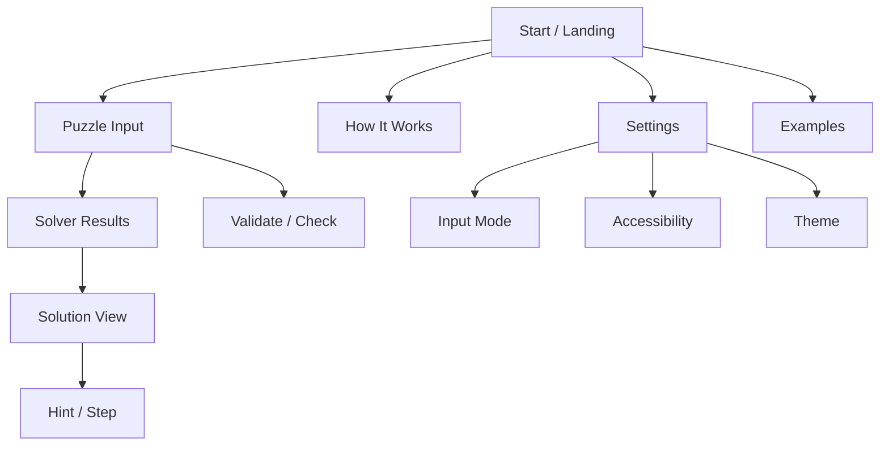
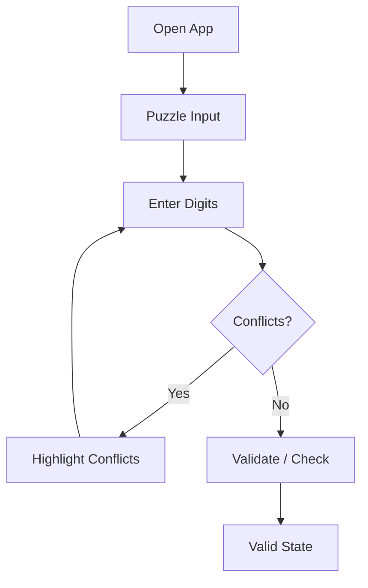
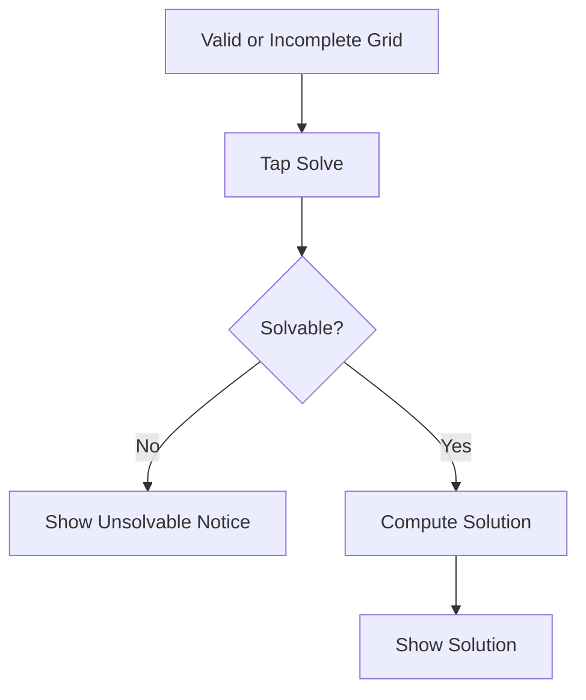
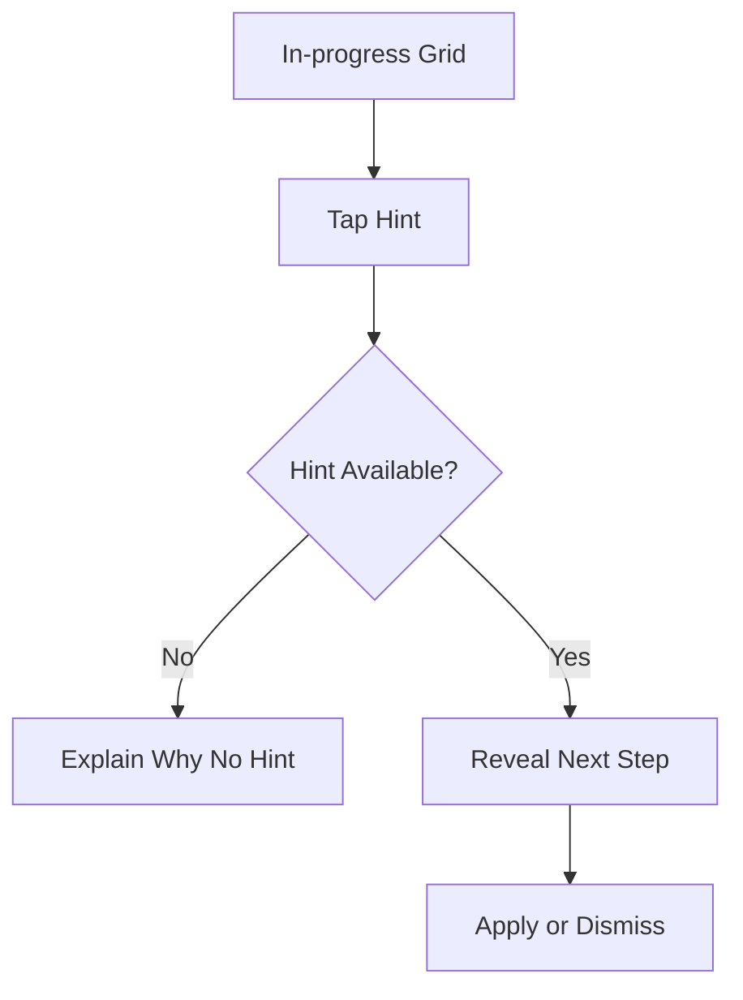

# Sudoku Solver UI/UX Specification

## Introduction
This document defines the user experience goals, information architecture, user flows, and visual design specifications for Sudoku Solver's user interface. It serves as the foundation for visual design and frontend development, ensuring a cohesive and user-centered experience.

## Overall UX Goals & Principles
### Target User Personas
- **Puzzle Enthusiast:** Regular solvers who want a clean, focused grid and fast solve/verify workflows.
- **Learner:** New or improving solvers who need hints, explanations, and gentle guidance.
- **Power Solver:** Advanced users who want keyboard-first input, minimal friction, and analytics.

### Usability Goals
- Ease of learning: First-time users can enter a puzzle and get a solution within 2 minutes.
- Efficiency of use: Frequent users can input a full grid with minimal clicks or keystrokes.
- Error prevention: Conflicting entries are caught immediately with clear, non-blocking feedback.
- Clarity of progress: Users always see whether the puzzle is solvable and what the next step is.

### Design Principles
1. **Clarity over decoration** - Prioritize legible grid states and unambiguous feedback.
2. **Feedback for every move** - Immediate validation keeps users confident and in flow.
3. **Minimize input friction** - Keyboard and touch both feel fast and forgiving.
4. **Respect the grid** - The puzzle remains the visual center; controls stay secondary.
5. **Accessible by default** - Contrast, focus, and sizing are treated as first-class.

## Information Architecture (IA)
### Site Map / Screen Inventory

### Navigation Structure
**Primary Navigation:** Single top bar with links to Puzzle Input, How It Works, Examples, and Settings. On mobile, this collapses into a menu.

**Secondary Navigation:** Within the Puzzle Input/Solver area, use a local control row for Validate, Solve, Hint, Clear, and Import/Export.

**Breadcrumb Strategy:** No breadcrumbs; the app is shallow. Use a persistent page title and highlighted nav state instead.

## User Flows
### Enter Puzzle & Validate
**User Goal:** Enter a Sudoku grid quickly and confirm it is valid.

**Entry Points:** Landing -> Puzzle Input; Examples -> Load example.

**Success Criteria:** Grid has 0 conflicts; user sees "Valid" state and can solve.

#### Flow Diagram

#### Edge Cases & Error Handling:
- Pasting invalid characters: ignore and show brief inline message.
- Conflicting digits: highlight conflicting cells and show non-blocking warning.
- Incomplete grid: allow validation but indicate "Incomplete".

**Notes:** Validation should be instant and not block continued entry.

### Solve Puzzle
**User Goal:** Solve the puzzle fully with one action.

**Entry Points:** Puzzle Input -> Solve; Solution View -> Solve.

**Success Criteria:** Full solution displayed; unsolved cells filled, given cells preserved.

#### Flow Diagram

#### Edge Cases & Error Handling:
- Unsolvable puzzle: show reason hint and keep grid editable.
- Multiple solutions: warn and choose first, or require confirm.
- Long solve time: show spinner and allow cancel.

**Notes:** Preserve user-entered digits; highlight filled cells.

### Hint / Step
**User Goal:** Get a single helpful step without revealing the full solution.

**Entry Points:** Solution View -> Hint; Puzzle Input -> Hint.

**Success Criteria:** One cell or technique shown with brief explanation.

#### Flow Diagram

#### Edge Cases & Error Handling:
- No valid hint: message suggests validate or adjust entries.
- Hint conflicts with user error: explain conflict and suggest correction.

**Notes:** Keep hint copy short; offer "Show Another" only after user acts.

## Wireframes & Mockups
**Primary Design Files:** TBD (Figma recommended)

### Key Screen Layouts
#### Puzzle Input
**Purpose:** Primary workspace for entering and validating a Sudoku puzzle.

**Key Elements:**
- 9x9 grid with bold 3x3 subgrid separators
- Number pad + keyboard hints
- Action row: Validate, Solve, Hint, Clear

**Interaction Notes:** Grid supports click/tap and keyboard navigation; conflicts are highlighted immediately.

**Design File Reference:** TBD

#### Solution View
**Purpose:** Show completed solution and allow step-by-step hints.

**Key Elements:**
- Completed grid with user-entered vs solved digits differentiated
- Status summary (Valid, Solved, Unsolvable)
- Hint panel or callout

**Interaction Notes:** Allow toggling between "show all" and "show step"; keep grid centered.

**Design File Reference:** TBD

#### Settings
**Purpose:** Adjust input, accessibility, and theme preferences.

**Key Elements:**
- Input mode toggle (keyboard-first / touch-first)
- Accessibility toggles (high contrast, larger grid)
- Theme selection

**Interaction Notes:** Instant preview of changes where possible.

**Design File Reference:** TBD

## Component Library / Design System
**Design System Approach:** Lightweight custom system tailored to Sudoku grid interactions; reuse existing UI primitives where available.

### Core Components
#### Sudoku Grid
**Purpose:** Primary interaction surface for puzzle entry and display.

**Variants:** Input mode, Solution mode, Hint-highlighted.

**States:** Default, focus, conflict, given (locked), solved (filled), hint.

**Usage Guidelines:** Keep cell size large enough for touch; highlight rows/cols on focus.

#### Number Pad
**Purpose:** Fast digit entry on touch devices.

**Variants:** Compact (mobile), full (tablet/desktop).

**States:** Default, disabled (when cell locked), active (last used).

**Usage Guidelines:** Always visible on mobile; optional on desktop if keyboard is primary.

#### Action Bar
**Purpose:** Provide primary actions (Validate, Solve, Hint, Clear).

**Variants:** Horizontal (desktop), stacked (mobile).

**States:** Default, disabled (action not available), loading.

**Usage Guidelines:** Keep actions prominent but secondary to grid.

#### Status Banner
**Purpose:** Communicate validation, solvability, and error states.

**Variants:** Info, success, warning, error.

**States:** Static, dismissible.

**Usage Guidelines:** Use concise text; do not block grid.

## Branding & Style Guide
### Visual Identity
**Brand Guidelines:** None yet; define a calm, focused aesthetic suitable for puzzle solving.

### Color Palette
| Color Type | Hex Code | Usage |
| --- | --- | --- |
| Primary | #1F5E8C | Primary buttons, links, focused cell |
| Secondary | #2F3E46 | Headers, secondary actions |
| Accent | #F4B000 | Hint highlights, callouts |
| Success | #2E8B57 | Valid state, solved indicator |
| Warning | #E67E22 | Conflict warnings |
| Error | #C0392B | Unsolvable, critical errors |
| Neutral | #F7F7F7 / #DADDE1 / #1F2933 | Backgrounds, borders, text |

### Typography
#### Font Families
- **Primary:** "Manrope", sans-serif
- **Secondary:** "Source Serif 4", serif
- **Monospace:** "JetBrains Mono", monospace

#### Type Scale
| Element | Size | Weight | Line Height |
| --- | --- | --- | --- |
| H1 | 32px | 700 | 1.2 |
| H2 | 24px | 600 | 1.3 |
| H3 | 20px | 600 | 1.35 |
| Body | 16px | 400 | 1.5 |
| Small | 13px | 400 | 1.45 |

### Iconography
**Icon Library:** Lucide

**Usage Guidelines:** Use simple line icons; reserve icons for secondary affordances.

### Spacing & Layout
**Grid System:** 12-column, max width 1200px

**Spacing Scale:** 4, 8, 12, 16, 24, 32, 48

## Accessibility Requirements
### Compliance Target
**Standard:** WCAG 2.1 AA

### Key Requirements
**Visual:**
- Color contrast ratios: 4.5:1 for body text, 3:1 for large text and UI elements
- Focus indicators: 2px outline with high contrast; never remove focus styling
- Text sizing: Base 16px, user-scalable up to 200% without layout break

**Interaction:**
- Keyboard navigation: Full grid navigation (arrows, tab/shift-tab), visible focus
- Screen reader support: ARIA labels for cells, row/col coordinates, status changes announced
- Touch targets: Minimum 44x44px for interactive elements

**Content:**
- Alternative text: Provide text labels for icons; avoid icon-only actions
- Heading structure: Semantic H1-H3 hierarchy in each view
- Form labels: Explicit labels for settings and input modes

### Testing Strategy
Manual keyboard-only pass, screen reader spot checks (NVDA/VoiceOver), and automated audits (Lighthouse/axe).

## Responsiveness Strategy
### Breakpoints
| Breakpoint | Min Width | Max Width | Target Devices |
| --- | --- | --- | --- |
| Mobile | 0px | 599px | Phones |
| Tablet | 600px | 1023px | Small tablets |
| Desktop | 1024px | 1439px | Laptops, desktops |
| Wide | 1440px | - | Large monitors |

### Adaptation Patterns
**Layout Changes:** Grid stays centered; controls stack below on mobile and sit to the right on desktop.

**Navigation Changes:** Primary nav collapses to a menu on mobile; keep "Puzzle Input" as default.

**Content Priority:** Grid and action bar first; hints and explanations move below on small screens.

**Interaction Changes:** Enable larger cell sizes and a persistent number pad on mobile.

## Animation & Micro-interactions
### Motion Principles
Subtle, purposeful motion only; never distract from the grid. Prefer 150-250ms durations and ease-out curves.

### Key Animations
- **Cell entry:** Digit fades in with slight scale-up (Duration: 120ms, Easing: ease-out)
- **Conflict highlight:** Quick pulse on conflicting cells (Duration: 180ms, Easing: ease-in-out)
- **Solve reveal:** Row-by-row or block-by-block fill (Duration: 300ms, Easing: ease-out)
- **Hint focus:** Soft glow around target cell (Duration: 200ms, Easing: ease-out)

## Performance Considerations
### Performance Goals
- **Page Load:** < 2s on broadband, < 4s on 3G
- **Interaction Response:** < 100ms for grid input and validation
- **Animation FPS:** 60 FPS for grid and highlights

### Design Strategies
Favor CSS-only animations, avoid heavy shadows, and minimize layout shifts by keeping grid size stable.